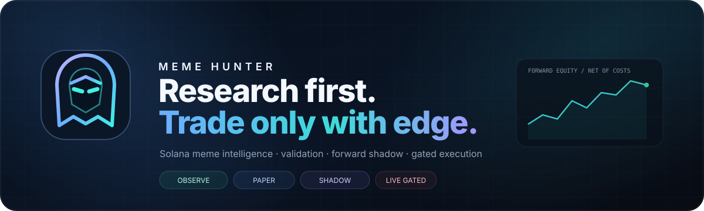
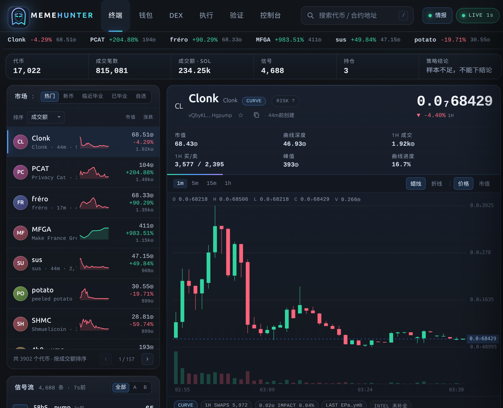
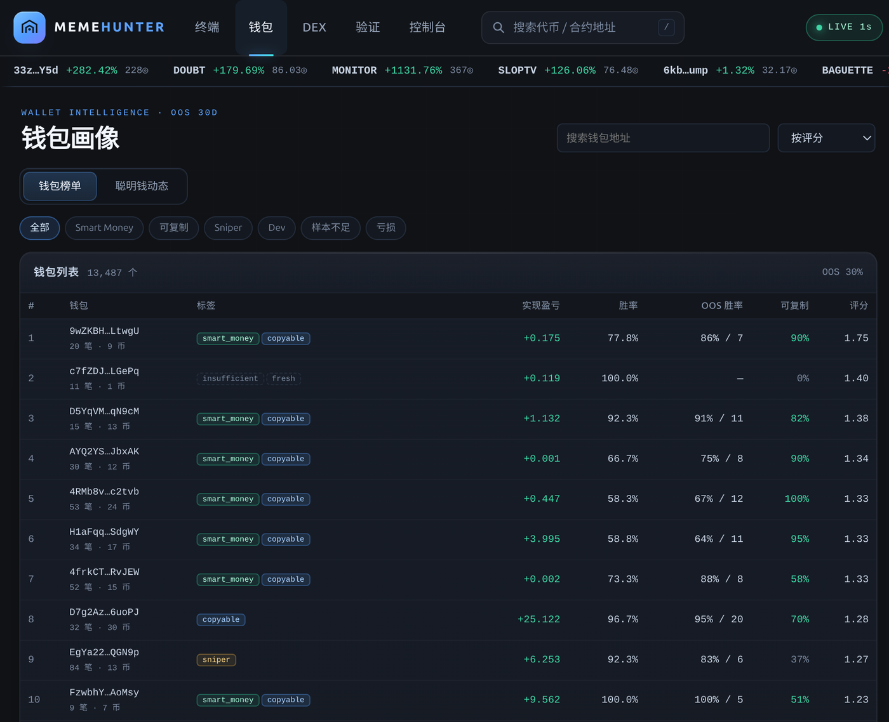
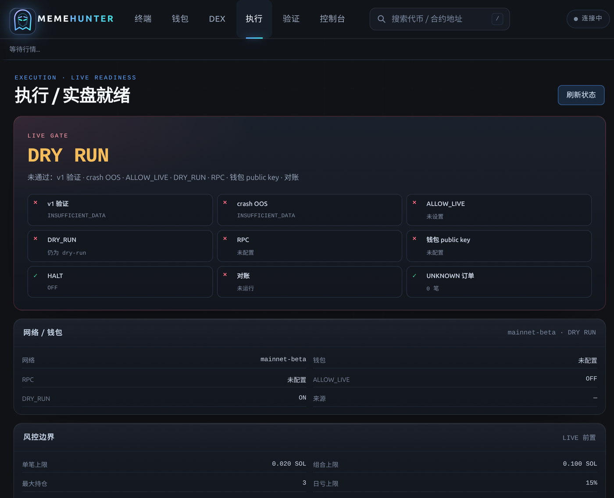
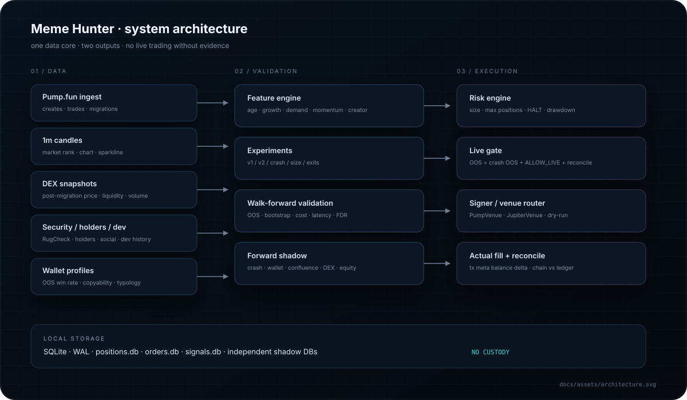

<p align="center">
  
</p>

<h1 align="center">Meme Hunter</h1>

<p align="center">
  <strong>Solana meme intelligence · validation · forward shadow · gated execution</strong><br/>
  A self-hosted research terminal that refuses to trade without evidence.
</p>

<p align="center">
  <code>Node.js 24</code> · <code>SQLite</code> · <code>Solana</code> · <code>Zero-build UI</code> · <code>Paper / Shadow / Live-gated</code>
</p>

---

## 为什么做这个

Meme 市场不是“找到一个指标就能赚钱”的市场。

大多数代币会归零，少数尾部交易贡献几乎全部收益；而手续费、滑点、MEV、卖出失败和欺诈代币会持续吃掉利润。

Meme Hunter 的目标不是再做一个“看起来很热闹”的看板，而是建立一个完整闭环：

```text
发现 → 安全过滤 → 特征 → 评分/策略 → 回测 → walk-forward
     → forward shadow → 成本/延迟压力 → 极小资金实盘
```

> **Research first. Trade only with edge.**  
> 没有通过验证的候选，不会进入真实资金。

---

## 核心能力

| 模块 | 能力 |
|---|---|
| **发现** | 热门、新币、临近毕业、已毕业、自选；1m K 线、成交额、买卖盘、曲线进度 |
| **安全** | RugCheck、mint/freeze、Top10、LP、Dev 历史、风险 flags、holders、社交 |
| **钱包情报** | OOS 画像、win rate、copyability、one-hit / diversified / sniper / dev 类型 |
| **DEX** | 迁移后价格、USD 流动性、24h 成交量、DEX 快照 |
| **策略研究** | v1 / v2 veto-only / crash / 仓位 / 退出 / 流动性缩放 / 冲击上限 |
| **严格验证** | walk-forward、cluster bootstrap、成本压力、延迟压力、随机基线、FDR、参数敏感性 |
| **Forward shadow** | crash / wallet / confluence / DEX 多账本；独立 SQLite，不吃资金 |
| **执行就绪** | live gate、public key、风险边界、对账、实际成交解析、Testnet/Dry-run checklist |
| **控制台** | 系统、数据、任务、HALT、实验、shadow、SSE 事件 |
| **运维** | systemd + supervisor，8+ 个服务自动重启，日志持久化 |

---

## 界面

### 终端

<p align="center">
  
</p>

左列发现，中列图表/持仓/成交，右侧评分、测算、验证和代币情报。  
窄屏时右侧情报进入抽屉，风险信息优先。

### 钱包与聪明钱

<p align="center">
  
</p>

钱包榜单与聪明钱动态切换；支持 OOS、copyability、one-hit、diversified 等类型标签。

### 执行 / 实盘就绪

<p align="center">
  
</p>

包含 LIVE GATE、网络/钱包 public key、风控边界、启动对账、订单/持仓、Forward Equity、Testnet/Dry-run checklist。

> 页面不会显示、接收或保存私钥。

---

## 系统架构

<p align="center">
  
</p>

### 一条数据核心，两种输出

```text
                 ┌────────────────────┐
Pump.fun ───────▶│                    │
DEX snapshots ──▶│   SQLite + WAL     │──▶ Research / Alerts
Security ───────▶│   event features   │──▶ Validation / Shadow
Wallets ────────▶│                    │──▶ Gated Execution
                 └────────────────────┘
```

- 只读主库，研究不会写坏采集数据；
- forward shadow 使用独立 SQLite；
- execution 与 research 解耦；
- live 需要双重门禁 + 启动对账。

---

## 当前状态（诚实版）

> **目前没有证明出稳定盈利的候选，实盘保持锁定。**

当前数据约：

| 指标 | 数值 |
|---|---:|
| Tokens | ~17k |
| Trades | ~815k |
| 有效成交 | ~5h |
| DEX snapshots | ~8k |
| Wallet profiles | ~45k |
| Risk records | ~700+ |

最新验证：

- v1：样本外期望约 **-0.03 SOL/笔**
- 全样本实验：**0/12 正期望**
- crash walk-forward：**-0.0041 SOL/笔**，PF **0.54**
- crash bootstrap 95% CI：**[-0.0068, -0.0012]**
- 所有 shadow 剔除最好一笔后，毛期望仍为负
- 合计 shadow PnL：约 **-2 SOL**

这意味着：

> **问题不在 UI，也不是“再调一个参数”。当前信号本身没有正 edge。**

我们不把回测调成绿色来制造盈利假象。

---

## 快速开始

```bash
# 1) 安装
npm install

# 2) 一键托管：collect + server + paper runner + shadows
npm run up
# 打开 http://127.0.0.1:8787/

# 3) 停止
npm run down
```

长期运行建议使用 systemd：

```bash
mkdir -p ~/.config/systemd/user
cp deploy/meme-hunter.service ~/.config/systemd/user/
systemctl --user daemon-reload
systemctl --user enable --now meme-hunter
loginctl enable-linger "$USER"
```

---

## 常用命令

| 命令 | 作用 |
|---|---|
| `npm run up` / `npm run down` | 启动/停止全部服务 |
| `npm run collect` | ingest + trades + candles + DEX + enrich |
| `npm run server -- --port 8787` | API + 静态前端 |
| `npm run runner -- --sim` | 纸面 runner |
| `npm run validate` | v1 严格验证 |
| `npm run validate:crash` | crash 风险版 walk-forward |
| `npm run experiments` | v1 / v2 / crash / 仓位 / 退出矩阵 |
| `npm run wallets2` | 重建 OOS 钱包画像 |
| `npm run dex` | 迁移后 DEX 快照 |
| `npm run report:daily` | 每日证据报告 |
| `npm run reconcile:live` | 实盘启动前对账 |
| `npm run live:selftest` | devnet/testnet 交易管道自检 |

---

## 页面

```text
#terminal    终端 / K线 / 持仓 / 代币情报
#wallets     钱包画像 / 聪明钱动态
#dex         迁移后 DEX 市场
#live        执行 / 实盘就绪 / Forward Equity
#validation  策略验证报告
#console     系统控制台 / 任务 / HALT
```

---

## 安全与边界

- 私钥只进入 live runner / reconcile，不进入 server / 前端 / 日志；
- `DRY_RUN` 默认开启，只有显式 `DRY_RUN=0` 才会广播；
- live 需要 `ALLOW_LIVE=1` + v1/crash 均为 `GO_LIVE` + 对账通过；
- 任何失败直接 exit 3；
- `data/HALT` 是硬熔断；
- 不做杠杆、马丁格尔、全仓单币；
- 不伪造安全字段，未知保持 `null`。

> **本项目是研究/工程系统，不构成投资建议。Meme 交易可能损失全部本金。**

---

## 目录

```text
src/
  ingest.mjs / trades.mjs     采集
  collect.mjs                 采集总控
  server.mjs                  API + 静态前端
  runner.ts                   paper / live runner
  validate.ts                 v1 严格验证
  validate-crash.ts           crash walk-forward
  shadow.ts                   crash / wallet forward shadow
  shadow-dex.ts               DEX forward shadow
  wallets2.ts                 OOS 钱包画像
  enrich.ts                   安全 / holders / Dev / 社交 / DEX
  live/                       config / fill / chain / router / selftest
  engine/                     特征、评分、风控、回测、统计
web/                          零构建终端界面
docs/                         设计、验证、实盘接入文档
docs/assets/                  README SVG / 截图
data/                         SQLite / 报告 / HALT（默认不入库）
deploy/                       systemd service
```

---

## 文档

- [`docs/README.md`](docs/README.md) — 文档索引
- [`docs/01-overview.md`](docs/01-overview.md) — 系统总览
- [`docs/10-real-wallet-gap.md`](docs/10-real-wallet-gap.md) — MetaMask / Phantom 真实资金差距
- [`docs/design/core-engine.md`](docs/design/core-engine.md)
- [`docs/operations/runbook.md`](docs/operations/runbook.md)
- [`docs/design/terminal-and-validation.md`](docs/design/terminal-and-validation.md)
- [`docs/design/intel-console.md`](docs/design/intel-console.md)
- [`docs/operations/live-trading.md`](docs/operations/live-trading.md)
- [`docs/design/icon-options.html`](docs/design/icon-options.html)

---

<p align="center">
  <sub>Built for one question: does this actually have an edge?</sub>
</p>
